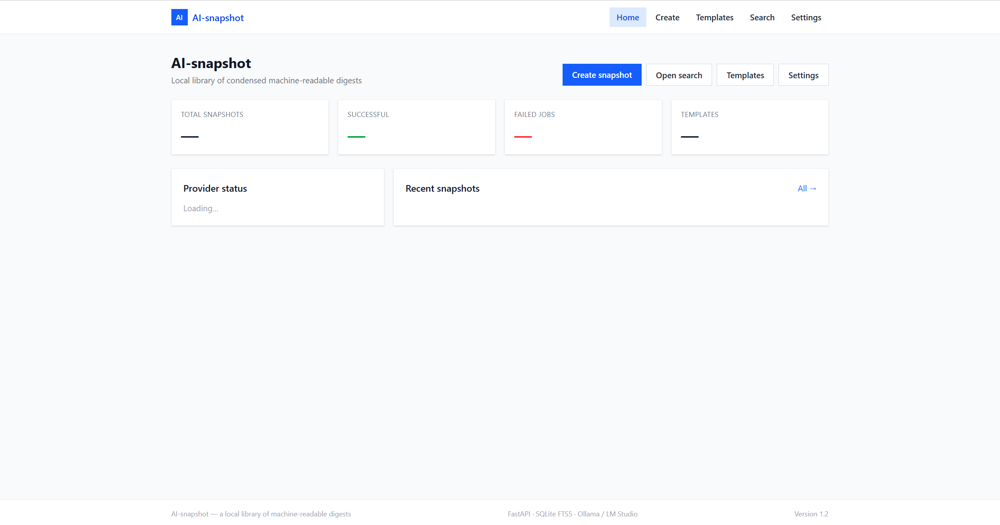
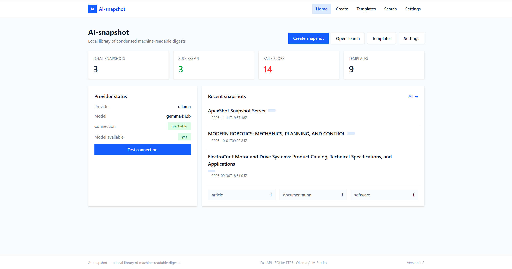
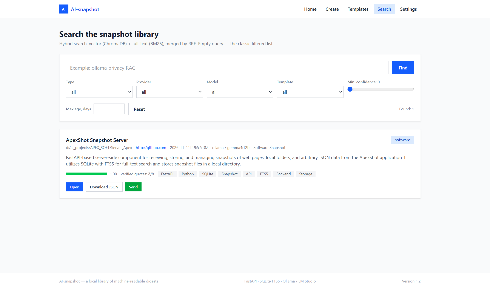
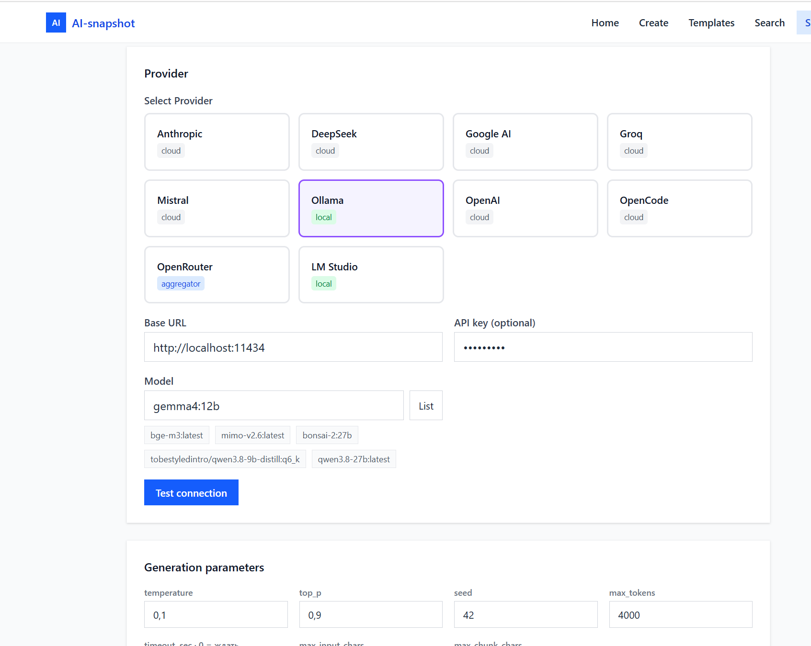
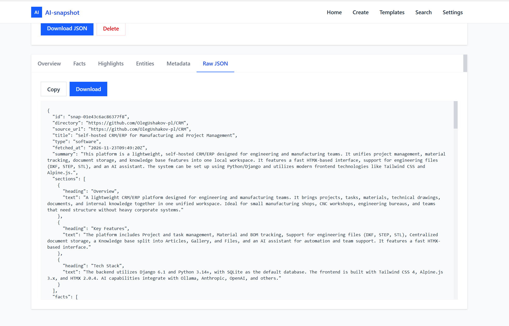

# ApexShot (ex AI-snapshot)

A local-first web application that turns local directories and web pages into small
machine-readable JSON snapshots ("AI blips") using LLMs, and provides hybrid search
over this library.

- FastAPI + Jinja2 + Tailwind CSS 4 (CDN) + Alpine.js (CDN)
- SQLite + FTS5 — lists, filters and the full-text fallback for the classic search API
- **Hybrid search**: ChromaDB (vector) + BM25 (full-text) merged with Reciprocal Rank
  Fusion — embeddings are computed locally by Ollama (`bge-m3`), no Docker, no cloud DB
- generation pipeline: file collection → text cleaning → chunking → LLM → JSON →
  quote verification → saving
- no snapshot versions: one directory (or URL) + one type = one snapshot (replacement
  without history)
- trilingual UI: **English** (default), **Polski**, **Русский** — switchable on the
  “Settings” page

## Providers

Local: **Ollama** (`http://localhost:11434`), **LM Studio** (`http://localhost:1234/v1`).

Cloud / aggregators (API key in Settings → masked, stored locally): **Anthropic, OpenAI,
Google AI, Mistral, Groq, DeepSeek, OpenRouter, OpenCode**.

Switching providers does not delete snapshots — `provider`/`model` are just filters in Search.

Embeddings for hybrid search always come from local Ollama, regardless of the chat provider.
On first start the app checks for the `bge-m3` model and pulls it (timeout 120 s). If Ollama
is unavailable, search degrades to BM25-only with `degraded: true` in the results —
the application keeps working and never returns an error instead of results.

## Search

Two search modes share the UI:

- **Hybrid query search** (default when a query is entered): `POST /api/search`,
  a ChromaDB vector index over local `data/snapshots/*.json` plus a BM25 index
  (`rank_bm25`, pure Python) merged by RRF (k = 60). Each result is
  `{id, title, summary, source_url, score, matched_fields, snippet, degraded}`.
  A browser extension (e.g. Chrome) may call the same endpoint — CORS is enabled for
  `chrome-extension://` origins.
- **Classic list search** (empty query): `GET /api/snapshots` with filters
  (type / provider / model / template / confidence / age) backed by SQLite FTS5
  with a `LIKE` fallback.

Both search indexes are built only from **local** snapshot files and are rebuilt on
startup, after a new snapshot is generated and after a deletion. Sending a snapshot
to the remote server (backup action) does not affect the local index. The server-side
application is a dumb remote store — search never happens there, and no hybrid index
is added to it.

## Run

**Windows:** `install.bat` — install only (`.venv` + dependencies), `start.bat` — install if needed and start the server.

Manual run:

```bash
python -m venv .venv
source .venv/bin/activate        # Windows: .venv\Scripts\activate
pip install -r requirements.txt
uvicorn app.main:app --reload --host 127.0.0.1 --port 8000
```

Requirements: Python 3.11+. Everything runs locally; the only network calls are to
your configured LLM provider and the local Ollama embedding server.

App: <http://127.0.0.1:8000>

## Pages

| Route | Purpose |
|---|---|
| `/` | Home: statistics, provider status, recent snapshots |
| `/create` | Snapshot creation (directory or URL) with progress and replacement of the existing one |
| `/templates` | Template CRUD, enabling, default, prompt testing |
| `/search` | Hybrid query search (score / matched fields / snippet per result) + classic filtered list |
| `/snapshots/{id}` | Details: Overview / Facts / Highlights / Entities / Metadata / Raw JSON |
| `/settings` | Provider, generation parameters, active templates per type |

## API

```
GET    /api/health
GET    /api/stats
GET    /api/meta
GET    /api/settings            PUT /api/settings
POST   /api/providers/test
GET    /api/models
GET    /api/templates           POST /api/templates
GET    /api/templates/{id}      PUT /api/templates/{id}    DELETE /api/templates/{id}
POST   /api/templates/{id}/default
POST   /api/templates/{id}/enabled?enabled=true
POST   /api/templates/{id}/test
POST   /api/snapshots
GET    /api/snapshots/exists?directory=&snapshot_type=
GET    /api/snapshots?query=&type=&provider=&model=&template_id=&min_confidence=&max_age_days=&limit=&offset=
GET    /api/snapshots/{id}      GET /api/snapshots/{id}/raw   DELETE /api/snapshots/{id}
POST   /api/snapshots/{id}/send
GET    /api/jobs/{job_id}
GET    /api/files?directory=
POST   /api/search
```

### `GET /api/health`

Returns, among other things, the hybrid search state:

```json
{
  "status": "ok",
  "ollama": {"available": true, "model": "bge-m3"},
  "vector_index_size": 7,
  "chroma_available": true
}
```

### `POST /api/search`

Request body: `{"query": "ollama privacy", "top_k": 10}`.

Response:

```json
{
  "results": [
    {
      "id": "snap-03183dd4024f7a49",
      "title": "Ollama privacy guide",
      "summary": "Running local LLMs privately…",
      "source_url": "https://example.com/ollama",
      "score": 0.0321,
      "matched_fields": ["vector", "facts"],
      "snippet": "…first matching fact/summary, ~200 chars…",
      "degraded": false
    }
  ],
  "total": 1,
  "search_ms": 2.1
}
```

`degraded: true` means the vector leg was skipped (Ollama unavailable or the embedding
request failed/timed out) and results come from BM25 only. `score` is the RRF score —
results found by both engines rank higher than results found by one.

## Data

```
data/
  snapshots.db        # settings, templates, snapshots, jobs, snapshots_fts
  snapshots/*.json    # snapshots themselves (usually 1–10 KB)
  chroma_data/        # hybrid search vector index (ChromaDB PersistentClient)
```

The root data directory is moved with the `SHOT_DATA_DIR` environment variable.

## Environment variables

| Variable | Default | Purpose |
|---|---|---|
| `SHOT_DATA_DIR` | `<repo>/data` | Root data directory (SQLite, snapshots) |
| `SHOT_CHROMA_DIR` | `<data>/chroma_data` | Location of the ChromaDB vector index |
| `SHOT_SEARCH_OLLAMA_URL` | `http://localhost:11434` | Ollama used for embeddings (`bge-m3`) |

## Configuration

Before the first run, open **Settings**: select a provider, specify the model (or API key
for cloud providers), and test the connection with “Test”.

Generation has no hard time limit by default: `timeout_seconds = 0` means “wait for the
model as long as it takes” (set any positive number of seconds to cap it). Local models
missing on the current machine are resolved automatically at request time (same model
family first), so shared settings work across computers with different local models.

In the **“Interface language”** block you can switch the UI language: `English` / `Polski` / `Русский`
(English by default, the value is stored in the `settings` table).

Nine built-in templates (article / documentation / news / forum / notes / general /
software / site / webpage) are created automatically on first launch.

## Project structure

```
app/
  main.py             # FastAPI app, lifespan (index build), CORS for extensions
  config.py           # paths, providers, search constants
  database.py         # SQLite: settings, templates, snapshots, jobs, FTS5
  schemas.py          # pydantic request/response models
  api/routes.py       # REST endpoints
  api/search.py       # POST /api/search
  search/             # hybrid search core (framework-agnostic)
    corpus.py         # local snapshot files -> documents
    vector_index.py   # ChromaDB: rebuild / upsert / delete / query
    bm25_index.py     # in-memory BM25 (rank_bm25)
    fusion.py         # Reciprocal Rank Fusion
    ollama_client.py  # /api/embed, /api/tags, /api/pull wrappers
  services/           # generation, templates, sending, settings, classic search
  templates/          # Jinja2 pages
  static/             # static assets
tests/                # pytest: 63 tests (classic search + hybrid, mocked Ollama)
```

## Tests

```bash
pytest -q
```

The hybrid search tests mock Ollama via `httpx.MockTransport`, so they run offline
and never touch a real Ollama instance. Covered: end-to-end hybrid results,
BM25-only degradation (`degraded: true`), RRF preference for documents found by
both engines, index updates after snapshot creation/deletion, and the HTTP contract
of `POST /api/search`.
